# Puffer Card — examples

Every picture on this page comes with the configuration that produces it. The entity IDs are placeholders: replace them with your own. The complete list of options is in the [README](README.md#options).

Everything shown here can also be set from the card's visual editor; YAML is only one way to write it down.

## Contents

- [Layouts](#layouts)
  - [Standard](#standard)
  - [Compact](#compact)
  - [Values only](#values-only)
  - [Two sensors](#two-sensors)
  - [Four sensors](#four-sensors)
- [History chart](#history-chart)
- [Extra values](#extra-values)
  - [Options](#options)
  - [Top](#top)
  - [Inside](#inside)
  - [Between tank and chart](#between-tank-and-chart)
  - [Bottom](#bottom)
  - [Left](#left)
  - [Visual editor](#visual-editor)

## Layouts

### Standard

The full tank with value badges on the side.

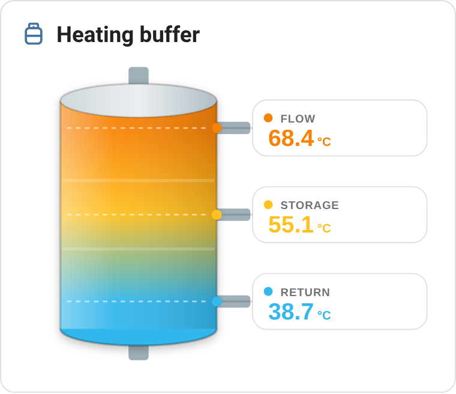

```yaml
type: custom:puffer-card
name: Heating buffer
icon: mdi:propane-tank-outline
top:
  entity: sensor.buffer_top
  label: Flow
middle:
  entity: sensor.buffer_middle
  label: Storage
bottom:
  entity: sensor.buffer_bottom
  label: Return
```

### Compact

A small tank next to a list of values, for dense dashboards.

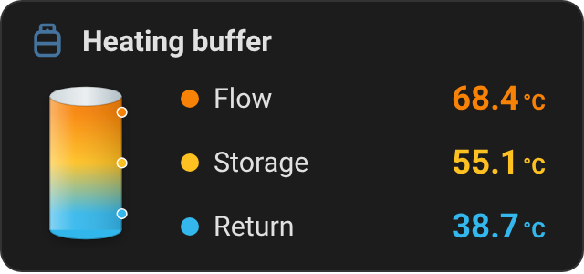

```yaml
type: custom:puffer-card
name: Heating buffer
icon: mdi:propane-tank-outline
layout: compact
top:
  entity: sensor.buffer_top
  label: Flow
middle:
  entity: sensor.buffer_middle
  label: Storage
bottom:
  entity: sensor.buffer_bottom
  label: Return
```

### Values only

With `show_labels: false` the labels are removed. In the compact layout the values move next to the tank.

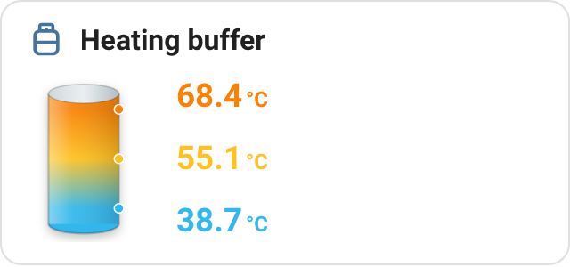

```yaml
type: custom:puffer-card
name: Heating buffer
icon: mdi:propane-tank-outline
layout: compact
show_labels: false
top:
  entity: sensor.buffer_top
  label: Flow
middle:
  entity: sensor.buffer_middle
  label: Storage
bottom:
  entity: sensor.buffer_bottom
  label: Return
```

### Two sensors

Configure only the positions you have. With fewer than four values they are spread evenly over the tank height instead of staying at the extremes.

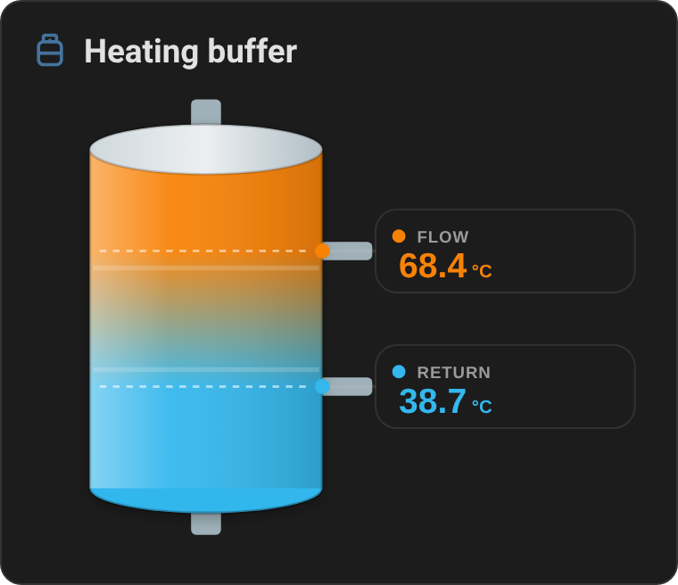

```yaml
type: custom:puffer-card
name: Heating buffer
icon: mdi:propane-tank-outline
top:
  entity: sensor.buffer_top
  label: Flow
bottom:
  entity: sensor.buffer_bottom
  label: Return
```

### Four sensors

With all four positions configured the tank grows taller and the badge text shrinks a little, so the four values stay comfortably spaced. The side pipes follow the number of configured sensors.

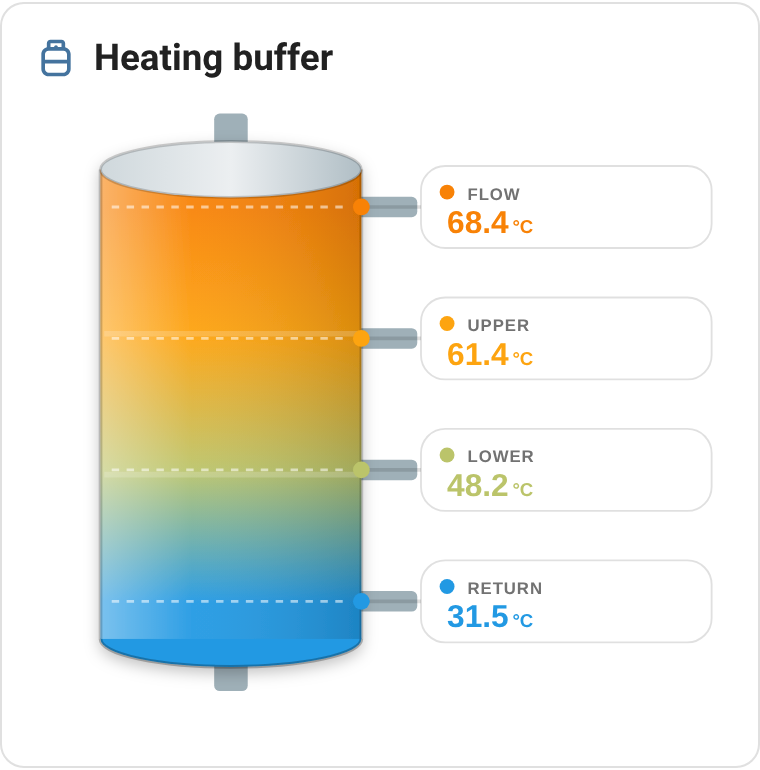

```yaml
type: custom:puffer-card
name: Heating buffer
icon: mdi:propane-tank-outline
top:
  entity: sensor.buffer_top
  label: Flow
middle:
  entity: sensor.buffer_upper
  label: Upper
extra:
  entity: sensor.buffer_lower
  label: Lower
bottom:
  entity: sensor.buffer_bottom
  label: Return
```

## History chart

`show_chart: true` adds a history chart below the tank (`chart_position: above` moves it on top). Each sensor gets a fixed color, and with more than one sensor in the chart the dots on the tank switch to the same colors, so they double as the legend.

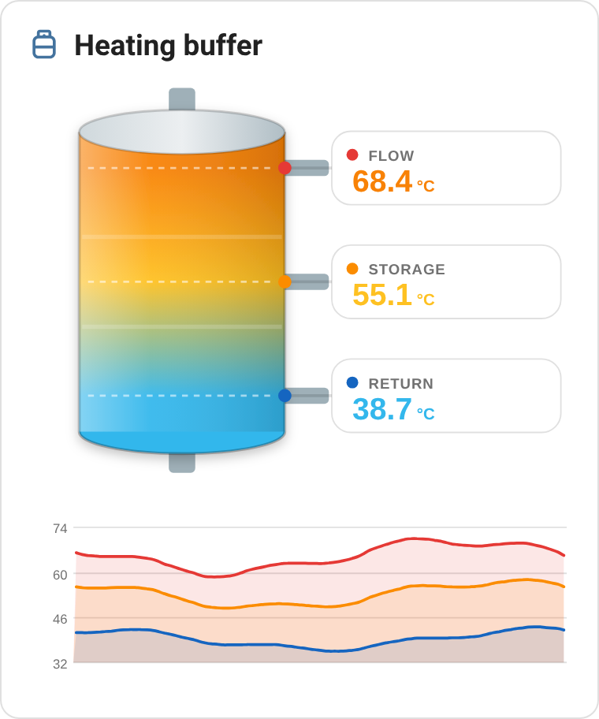

```yaml
type: custom:puffer-card
name: Heating buffer
icon: mdi:propane-tank-outline
show_chart: true
top:
  entity: sensor.buffer_top
  label: Flow
middle:
  entity: sensor.buffer_middle
  label: Storage
bottom:
  entity: sensor.buffer_bottom
  label: Return
```

The same chart in the compact layout:

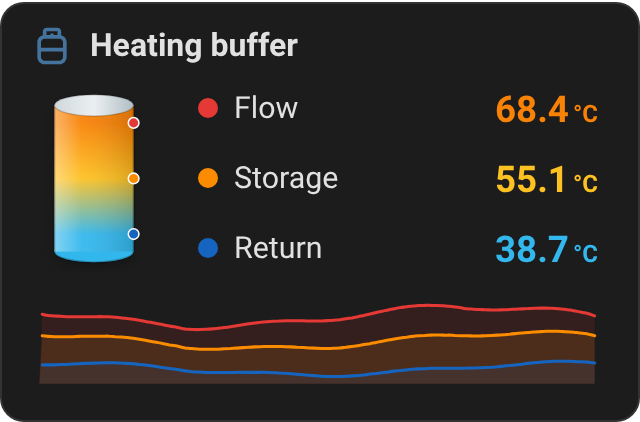

```yaml
type: custom:puffer-card
name: Heating buffer
icon: mdi:propane-tank-outline
layout: compact
show_chart: true
top:
  entity: sensor.buffer_top
  label: Flow
middle:
  entity: sensor.buffer_middle
  label: Storage
bottom:
  entity: sensor.buffer_bottom
  label: Return
```

`chart_hours` (2, 6, 12, 24 or 48), `chart_style` (`area` or `line`) and `chart_sensors` (which positions to draw) are described in the [README](README.md#options).

## Extra values

Besides the temperatures, the card can show up to four values from any entity: the system pressure, a pump or a valve, a setpoint. They are shown as they are — no color scale, no chart — and formatted by Home Assistant itself, so numbers follow your locale and states are translated (`on` becomes *Running* for a pump). Click a value to open the entity's more-info dialog.

### Options

`info_position` sets where the values go, `info` lists them:

```yaml
info_position: top        # top, inside, between, bottom or left
info:
  - entity: sensor.heating_pressure
    label: Pressure       # optional, defaults to the entity's name
    icon: mdi:gauge       # optional, defaults to the entity's icon
    show_label: true      # optional, see below
    show_icon: true       # optional, see below
```

| Key | Default | Description |
|---|---|---|
| `entity` | – | Any entity |
| `label` | entity name | Text shown next to the value, and as tooltip |
| `icon` | entity icon | Icon; without one, Home Assistant picks it from the domain and device class |
| `show_label` | depends on position | `true` / `false` to override the default |
| `show_icon` | depends on position | `true` / `false` to override the default |

Some positions have little room, so whether label and icon are shown depends on where the values go. Set `show_label` or `show_icon` on an entry to override it; when the label is hidden it is still shown as a tooltip.

| `info_position` | Label | Icon |
|---|---|---|
| `top` | hidden | shown |
| `inside` | shown, hidden in compact | hidden |
| `between` | shown | shown |
| `bottom` | shown | shown |
| `left` | shown, hidden in compact | hidden |

The examples below all use these two entries:

```yaml
info:
  - entity: sensor.heating_pressure
    label: Pressure
  - entity: binary_sensor.circulation_pump
    label: Pump
    icon: mdi:pump
```

The pressure sensor has no `icon`: the gauge comes from its `pressure` device class.

### Top

The default. The values sit in the title row, aligned right, so the card gets no taller. Labels are hidden by default to leave room for the title.

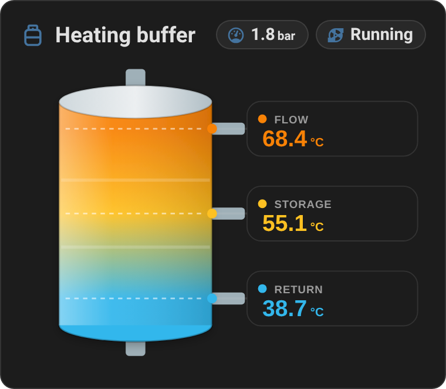

```yaml
type: custom:puffer-card
name: Heating buffer
icon: mdi:propane-tank-outline
top:
  entity: sensor.buffer_top
  label: Flow
middle:
  entity: sensor.buffer_middle
  label: Storage
bottom:
  entity: sensor.buffer_bottom
  label: Return
info_position: top
info:
  - entity: sensor.heating_pressure
    label: Pressure
  - entity: binary_sensor.circulation_pump
    label: Pump
    icon: mdi:pump
```

### Inside

The values are drawn on the tank body, in the gaps between the sensor lines. The card gets no taller.

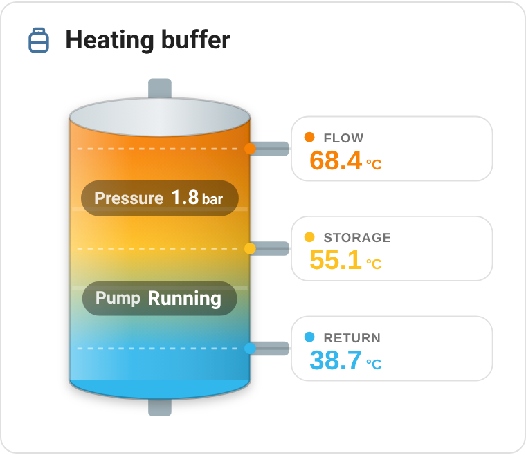

```yaml
type: custom:puffer-card
name: Heating buffer
icon: mdi:propane-tank-outline
top:
  entity: sensor.buffer_top
  label: Flow
middle:
  entity: sensor.buffer_middle
  label: Storage
bottom:
  entity: sensor.buffer_bottom
  label: Return
info_position: inside
info:
  - entity: sensor.heating_pressure
    label: Pressure
  - entity: binary_sensor.circulation_pump
    label: Pump
    icon: mdi:pump
```

> **Compact layout:** the small tank only has room for one value, so only the **first** `info` entry is shown, without its label. The others are ignored; pick another position if you need more.

### Between tank and chart

The values sit between the tank and the history chart, on whichever side the chart is. Without the chart this position behaves like `bottom`.

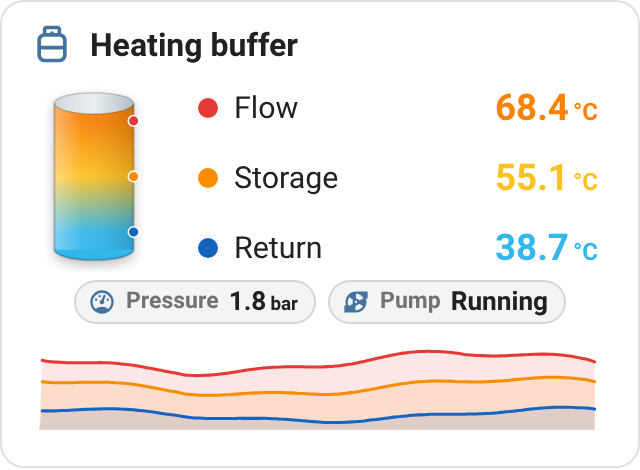

```yaml
type: custom:puffer-card
name: Heating buffer
icon: mdi:propane-tank-outline
layout: compact
show_chart: true
top:
  entity: sensor.buffer_top
  label: Flow
middle:
  entity: sensor.buffer_middle
  label: Storage
bottom:
  entity: sensor.buffer_bottom
  label: Return
info_position: between
info:
  - entity: sensor.heating_pressure
    label: Pressure
  - entity: binary_sensor.circulation_pump
    label: Pump
    icon: mdi:pump
```

### Bottom

The values sit at the very bottom of the card, below the chart if there is one. This position has the most room, so it is the most readable, at the cost of a slightly taller card.

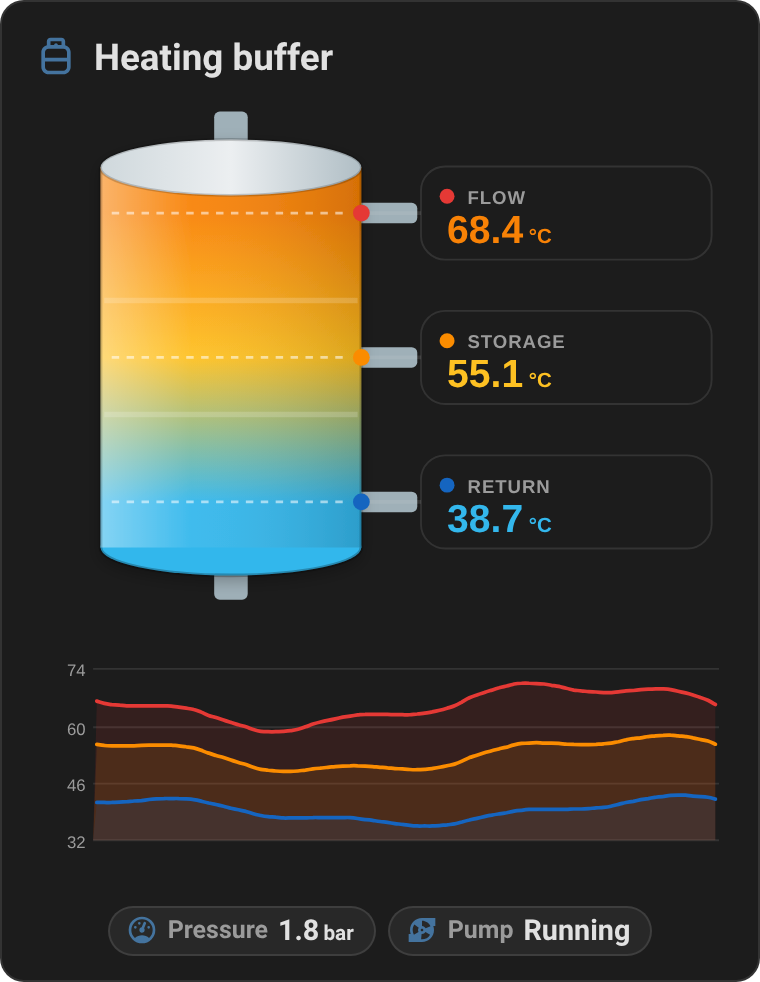

```yaml
type: custom:puffer-card
name: Heating buffer
icon: mdi:propane-tank-outline
show_chart: true
top:
  entity: sensor.buffer_top
  label: Flow
middle:
  entity: sensor.buffer_middle
  label: Storage
bottom:
  entity: sensor.buffer_bottom
  label: Return
info_position: bottom
info:
  - entity: sensor.heating_pressure
    label: Pressure
  - entity: binary_sensor.circulation_pump
    label: Pump
    icon: mdi:pump
```

### Left

The values run vertically along the left side of the tank, reading bottom to top, and the card gets no taller. In the standard layout they use the empty strip next to the tank, so keep the labels short. In the compact layout only the value is shown by default: set `show_icon: true` on the entries if you need to tell them apart.

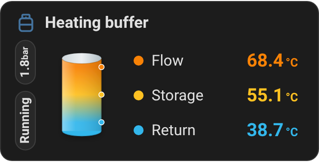

```yaml
type: custom:puffer-card
name: Heating buffer
icon: mdi:propane-tank-outline
layout: compact
top:
  entity: sensor.buffer_top
  label: Flow
middle:
  entity: sensor.buffer_middle
  label: Storage
bottom:
  entity: sensor.buffer_bottom
  label: Return
info_position: left
info:
  - entity: sensor.heating_pressure
    label: Pressure
  - entity: binary_sensor.circulation_pump
    label: Pump
    icon: mdi:pump
```

### Visual editor

The editor shows the position as a dropdown and the values as up to four sections, *Extra value 1* to *4*: one more appears as soon as the previous one is filled in. *Show label* and *Show icon* offer *Auto*, *Show* and *Hide*; *Auto* leaves the option out of the configuration, so the default of the chosen position applies.

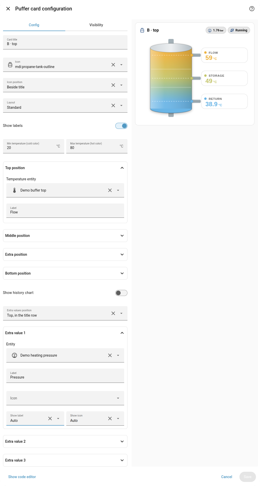
